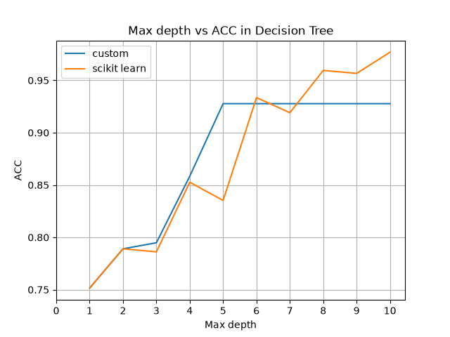

# 決定木の自作とsklearnとの比較

決定木（分類木）をPythonでスクラッチ実装し、scikit-learnの`DecisionTreeClassifier`と精度を比較した。自作の木が深いときに起こした問題の原因を突き止め、修正した。木の最大の深さ(`max_depth`)を変えた時の精度の違いを比較した。

## データ

- [UCI Machine Learning Repository: Car Evaluation](https://archive.ics.uci.edu/dataset/19/car+evaluation)

- データ総数: 1,728件

- 特徴量 (6個、全てカテゴリ変数): `buying`, `maint`, `doors`, `persons`, `lug_boot`, `safety`

- ラベル(4 クラス): 

    | label | 数 |
    |----|---|
    | `unacc` |1210|
    | `acc`   | 384|
    | `good`  | 69 |
    | `vgood` | 65 |

    `unacc`が約70%を占めている。

- データ分離
    訓練80% / テスト20% (訓練1,382件、テスト346件)、`random_state = 1`。

## 実装
### 自作
- **不純度**: ジニ不純度。情報利得(分割によるジニ不純度の減少)が最大の特徴量で分割する。
- **分割**: 選択した特徴量の値ごとに枝を作る多分岐
- **木の構築**: 再帰。`max_depth`に達するか、又は情報利得が0になったら葉にする。
- **ノード**: `Leaf`(葉)と`Internal_Node`(分岐)の2種類。どちらも、そのノードに到達した訓練データのラベルの集計を保持する。
- **予測**: 木をたどり、葉に着いたらその葉のラベルの多数派を返す。途中のノードに、入力の値に対応する枝がない場合は、そのノードの訓練データの多数派を返す(経緯は「実験2」を参照)。


### scikit-learn
カテゴリを`OrdinalEncoder`を用いて順序付きの数値に変換し(`low` < `med` < `high` < `vhigh`など)、`DecisionTreeClassifier`(`random_state=0`、不純度はデフォルトのジニ不純度)を使用した。


## 実験と結果 

### 実験1: 深さ3での比較
`max_depth=3`では、テストデータ346件のうち、自作とscikit-learnでは37件の予測の相違があった。自作では分割のために選択した特徴量の値ごとに、一度に枝を作成する(例: `safety`なら、`low`, `med`, `high`の3つに分かれる)。そのため、同じ深さであっても、scikit-learnよりも細かく分けることができる。これは設計の違いである。
両者の予測に相違のあった37件のうち、自作だけが正解したのが19件、scikit-learnだけが正解したのが16件、どちらも不正解で、予測したラベルも異なっていたのは2件だった。どちらが正解するかはほぼ同じ割合だった。それぞれの精度(ACC)を下の表にまとめた。

|   |自作|scikit-learn|
|---|---|---|
|精度(ACC)|0.795|0.786|

テストデータは346件であるので、データ1件あたりが精度に与える寄与は1/346≒0.0029であると見積もった。すると自作とscikit-learnの精度の差(0.009)は約3件分に相当する。これらのことから、深さ3における予測性能の大差はないと考えられる。

### 実験2: 深さ6での比較と、`None`が出る問題の修正
`max_depth=6`で自作とscikit-learnの比較をした。
- **症状**:自作の精度がscikit-learnの精度より低かった(0.899 vs 0.934)。予測結果を調べたところ、自作の予測に`None`が含まれていることが判明した(テストデータ346件中、約20件)。

- **原因**: 多分岐において、次の分割に作られる枝は、そのノードまでに到達した訓練データに実際に存在する値によるものだけである。このため深いノードほど到達する訓練データは少なくなり、それまでの分割で決めた値の組み合わせの先に、テストデータの次の特徴量の値が、訓練データに存在しない場合が発生する。そういった場合に関数`classify`は`None`を返す実装になっていた。

- **修正**:`Internal_Node`に、そのノードに到達した訓練データのラベルの値の集計を持たせた。テストデータに対応する枝がない時には、そのノードの多数派ラベルを返すように修正した。

- **結果**: `max_depth=6`のテスト精度が0.899から0.928に上昇した。`max_depth=3`の精度については`None`が発生しないために変化はなかった。`max_depth=6`の訓練精度は1.0であった。

### 実験3: 深さ1~10での比較


 
図: 実験3の結果(`None`の修正後、テストデータ346件、1回の分割)

表: `max_depth`ごとのテスト精度

| max_depth | 自作 | scikit-learn |
|---|---|---|
| 1 | 0.751 | 0.751 |
| 2 | 0.789 | 0.789 |
| 3 | 0.795 | 0.786 |
| 4 | 0.858 | 0.853 |
| 5 | 0.928 | 0.835 |
| 6 | 0.928 | 0.934 |
| 7 | 0.928 | 0.919 |
| 8 | 0.928 | 0.960 |
| 9 | 0.928 | 0.957 |
| 10 | 0.928 | 0.977 |

自作は深さ5以降では精度が0.928で一定であった。深さ6以降で木に変化がないことは、特徴量が6個で、自作は多分岐のために1本の道筋で同じ特徴量を再度使用することができないためである。深さ5で精度が頭打ちになることについては、最後の特徴量での分割において、テストデータの値に対応する枝がなく、多数派ラベルが返されるためと考えられる(未検証)。

scikit-learnでは全体として精度が伸び、深さ10で最大の0.977をとった。これはscikit-learnでは2分岐を採用しており、かつ順序付きの数値を閾値で分けるために同じ特徴量を分割に複数回使用することができ、順序の情報も活かせることが理由と考えられる(未検証)。

深さが浅いとき(3~5)では自作による木はscikit-learnによるものと比べて同等以上であり(深さ5では0.928対0.835)、深さ8以降ではscikit-learnによる木が上回った。

## 限界と今後

- カテゴリ変数のみに対応(数値の特徴量に対し未対応)、剪定なし
- 評価は、訓練/テストの分割が1通り(`random_state=1`)のみ。分割を変更することにより精度が変化する可能性があり、交差検証が必要だが未実施。

- データ: Car Evaluationのみ

## 今後の予定

- 交差検証により、深さを選ぶ
- 別のデータセットでの比較
- 数値特徴量への対応
- ROC曲線の描画

## 実行方法
### ライブラリ
```
pip install numpy pandas matplotlib scikit-learn graphviz
```

別途、Graphviz 本体(`dot` コマンド)が必要。Debian/Ubuntu なら `sudo apt-get install graphviz` で入れることができる(他の OS は https://graphviz.org/download/)。

### データ
上記UCIのページから`car.data`を入手し、スクリプトと同じフォルダに置く。

### 実行
- 実験1,2,3における自作とscikit-learnの予測差を比較する実験
```
python3 comparison_main.py
```

 ただし、実行時に木の深さを変更したい場合には`comparison_main.py` の末尾にある `max_depth` の値を書き換える(コミット時点では3。実験2は6)。

- 実験3における木の深さごと精度を計算する実験
```
python3 check_depth_main.py
```

### 動作確認環境 
Docker(ベースイメージ `python:3.11-slim`)、Python 3.11